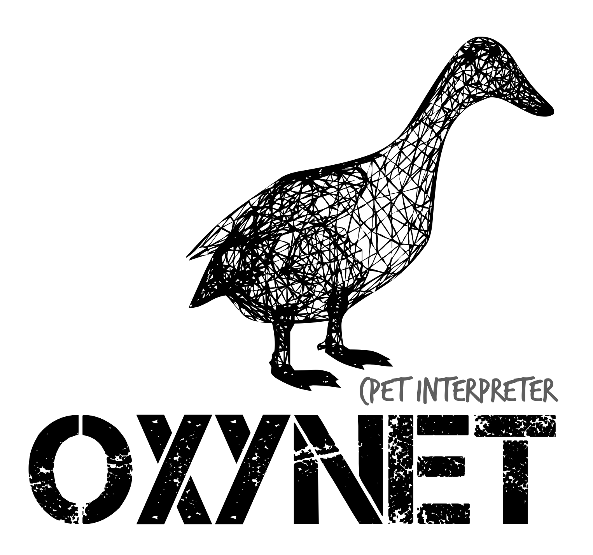
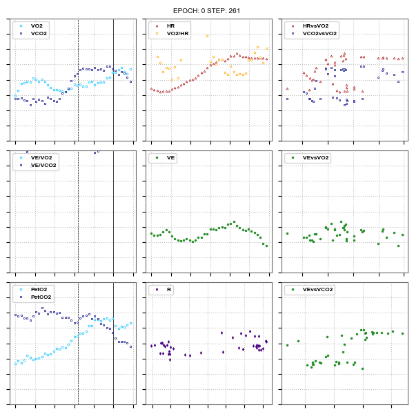

<div align="center">
  
  <h1>pyoxynet</h1>
  <p>The open-source models from the Oxynet research papers, for cardiopulmonary exercise test (CPET) data.</p>
  <p>
    <a href="https://pypi.org/project/pyoxynet/"></a>
    <a href="https://pypi.org/project/pyoxynet/"></a>
    <a href="https://pyoxynet.readthedocs.io/en/latest/"></a>
    <a href="LICENSE.txt"></a>
  </p>
  <p>
    <a href="https://www.oxynet.net"><strong>oxynet.net</strong></a>
    ·
    <a href="https://pyoxynet.readthedocs.io/en/latest/">Docs</a>
    ·
    <a href="https://pypi.org/project/pyoxynet/">PyPI</a>
    ·
    <a href="https://github.com/andreazignoli/pyoxynet/discussions">Discussions</a>
  </p>
</div>

Give pyoxynet a test and it returns, second by second, the model's output for the moderate, heavy
and severe exercise-intensity domains, and the two ventilatory thresholds (VT1 and VT2) where those
outputs cross. It can also generate synthetic tests. Everything runs on your machine: the models
are frozen LiteRT files, so TensorFlow is not needed.

## Looking for the hosted Oxynet API?

This repository is pyoxynet, the open-source research package. The Oxynet platform is a separate,
hosted service at [app.oxynet.net](https://app.oxynet.net), with its own, separately trained
models. It reads metabolic cart exports as they come off the cart (COSMED and Cortex among them,
detected automatically), checks the signals, and returns ventilatory thresholds (VT1 and VT2),
substrate use (FATMAX), exercise oscillatory ventilation and signal-quality checks as structured,
versioned JSON. API keys are free: [app.oxynet.net/signup](https://app.oxynet.net/signup).

- REST API: [OpenAPI schema](https://app.oxynet.net/v1/openapi.json) and
  [developer docs](https://www.oxynet.net/developers)
- AI assistants: a remote MCP server at `https://app.oxynet.net/oxynet-mcp`
- **AI agents:** to analyse a CPET file with Oxynet, start at
  [app.oxynet.net/llms.txt](https://app.oxynet.net/llms.txt). Upload the vendor file
  unchanged and let Oxynet compute the physiology.

Research software, not a diagnostic device. No result carries a confidence score.
Oscillatory ventilation analysis is beta: it was developed on one heart failure cohort and
its transportability is untested.

## Install

```sh
pip install pyoxynet
```

Python 3.10 to 3.14, on Windows, macOS and Linux. To install the development version:

```sh
pip install "git+https://github.com/andreazignoli/pyoxynet.git#subdirectory=pyoxynet"
```

`pip install "pyoxynet[train]"` adds TensorFlow, which only `pyoxynet.model` needs: it defines the
networks in Keras, for anyone who wants to retrain them. Inference and generation do not use it.

## Quick start

```python
import pyoxynet

# The bundled example test, through the default model
out_df, thresholds = pyoxynet.test_pyoxynet()

print(thresholds['VT1']['time'], round(thresholds['VT1']['VO2']))  # 372 2979
print(thresholds['VT2']['time'], round(thresholds['VT2']['VO2']))  # 550 3656
```

Each threshold gives its `time` (s) and the `VO2`, `VE` and `HR` there. `out_df` holds the three
domain outputs (`p_md`, `p_hv`, `p_sv`) over time, next to the signals.

## Your own test

```python
import pandas as pd
import pyoxynet

df = pd.read_csv('my_test.csv')
out_df, thresholds = pyoxynet.test_pyoxynet(input_df=df)
```

The columns `test_pyoxynet` reads:

| Column | Signal |
|---|---|
| `time` | seconds from the start of the test |
| `VO2_I` | oxygen uptake |
| `VCO2_I` | carbon dioxide output |
| `VE_I` | minute ventilation |
| `PetO2_I` | end-tidal O2 |
| `PetCO2_I` | end-tidal CO2 |
| `HR_I` | heart rate, optional: it is only reported at the thresholds |

- Any sampling works, breath by breath included. `test_pyoxynet` averages the data into
  one-second bins and interpolates linearly between them.
- Each signal is min-max scaled over the test before it reaches the model, so units do not change
  the domains. The VO2, VE and HR reported at each threshold are in your file's units.
- When the outputs never cross, no threshold can be placed and `test_pyoxynet` raises a
  `ValueError`.

## The models

| `model=` | What it is | Paper |
|---|---|---|
| `'CNN'`, the default | Oxynet's convolutional network, fine-tuned on ramp tests from the Murias lab | Evaluated in Keir et al. (2026) |
| `'LSTM'` | A recurrent network: one LSTM and one GRU layer | Follows the recurrent approach of Zignoli et al. (2019); not evaluated on its own |

```python
out_df, thresholds = pyoxynet.test_pyoxynet(input_df=df, model='LSTM')
```

- Both are research models, frozen as they are: they are not retrained.
- The evaluation in Keir et al. covered incremental tests in healthy individuals.
- The domain outputs are what the network gives, not calibrated probabilities, and pyoxynet
  reports no confidence score.

Where each file came from, how the two older ones were converted and how the conversion was
checked: [pyoxynet/pyoxynet/models/README.md](pyoxynet/pyoxynet/models/README.md). The models
offered before 1.0.0 (`murias_lab`, `AIS`, `NSWIS`, `TCN`, `LSTMGRUModel`) were removed. Asking
for one raises an error that names the available ones, and the earlier releases remain on PyPI.

## Synthetic and example tests

pyoxynet includes a conditional generative adversarial network (GAN) that generates synthetic
ramp tests, and 138 anonymised example tests.

```python
generator = pyoxynet.load_generator()
df, info = pyoxynet.generate_CPET(generator)        # a synthetic ramp test
out_df, thresholds = pyoxynet.test_pyoxynet(input_df=df)

df, info = pyoxynet.draw_real_test()                # one of the example tests
```

- `info['VT1']` and `info['VT2']` are the thresholds the test was generated or labelled with, in
  seconds.
- `generate_CPET(generator, fitness_group=0)` to `3` sets the fitness level, from very low to
  high.
- A generated test has VO2, VCO2, VE, HR, respiratory frequency, PetO2 and PetCO2, so a
  breath-by-breath version can be built from it.

The generator at different stages of its training:



## Questions and contributing

- Questions and ideas: [GitHub Discussions](https://github.com/andreazignoli/pyoxynet/discussions).
- Bugs: [issues](https://github.com/andreazignoli/pyoxynet/issues).
- Pull requests that fix the package are welcome. The models themselves are frozen.
- For research or data collaborations, see [oxynet.net](https://www.oxynet.net).

## Citing

If you use the CNN, cite:

> Keir DA, Zignoli A, Iannetta D, Mattioni Maturana F, Murias JM. AI-Driven Analysis of
> Cardiopulmonary Exercise Tests to Identify Gas Exchange and Ventilatory Thresholds. *Sports
> Medicine*. 2026;56(7):1833-1843.
> [doi:10.1007/s40279-026-02403-w](https://doi.org/10.1007/s40279-026-02403-w)

## Further reading

- Zignoli A, Fornasiero A, Stella F, Pellegrini B, Schena F, Biral F, Laursen PB. Expert-level
  classification of ventilatory thresholds from cardiopulmonary exercising test data with
  recurrent neural networks. *European Journal of Sport Science*. 2019;19(9):1221-1229.
  [doi:10.1080/17461391.2019.1587523](https://doi.org/10.1080/17461391.2019.1587523)
- Zignoli A, Fornasiero A, Rota P, et al. Oxynet: A collective intelligence that detects
  ventilatory thresholds in cardiopulmonary exercise tests. *European Journal of Sport Science*.
  2022;22(3):425-435. [doi:10.1080/17461391.2020.1866081](https://doi.org/10.1080/17461391.2020.1866081)
- Zignoli A. Machine Learning Models for the Automatic Detection of Exercise Thresholds in
  Cardiopulmonary Exercising Tests: From Regression to Generation to Explanation. *Sensors*.
  2023;23(2):826. [doi:10.3390/s23020826](https://doi.org/10.3390/s23020826)
- [Research](https://www.sciencedirect.com/science/article/abs/pii/S1746809423002690) on the
  collective intelligence approach to the automatic interpretation of CPET
- [Review](https://link.springer.com/article/10.1007%2Fs11332-019-00557-x) of the AI technologies
  applied to exercise cardiopulmonary and metabolic data
- [Research](https://journals.plos.org/plosone/article?id=10.1371/journal.pone.0229466) applying
  an LSTM network to estimate VO2 during cycling
- [Preprint](https://www.overleaf.com/read/fcmwscvyhtfq) on generating synthetic CPET data with
  conditional GANs
- [LinkedIn article](https://www.linkedin.com/pulse/oxynet-collective-intelligence-approach-test-andrea-zignoli/)
  about the Oxynet project
- [Blog post](https://andreazignoli.github.io/blog-post-5/) on adopting AI models to interpret
  CPET data
- Medium stories on
  [inference](https://medium.com/@andrea.zignoli/automatic-interpretation-of-cardiopulmonary-exercise-tests-with-deep-learning-2c9b3920ad51)
  and [generation](https://medium.com/@andrea.zignoli/automatic-generation-of-cardiopulmonary-exercise-tests-with-deep-learning-d1f2cab4e765)
  with pyoxynet (written for versions before 1.0.0)

## Acknowledgments

- [Uniplot](https://github.com/olavolav/uniplot), for the terminal plots
- [Machine Learning Mastery's conditional GAN tutorial](https://machinelearningmastery.com/how-to-develop-a-conditional-generative-adversarial-network-from-scratch/)
- [Exercise Thresholds](https://www.exercisethresholds.com/)

## License and contact

MIT, see [LICENSE.txt](LICENSE.txt). Andrea Zignoli, andrea.zignoli@unitn.it.

## Disclaimer

pyoxynet is research software, not a medical device. Its results are for information only and
are not a substitute for professional medical advice, diagnosis or treatment. Always seek the
advice of a qualified health provider with any question about a medical condition.
